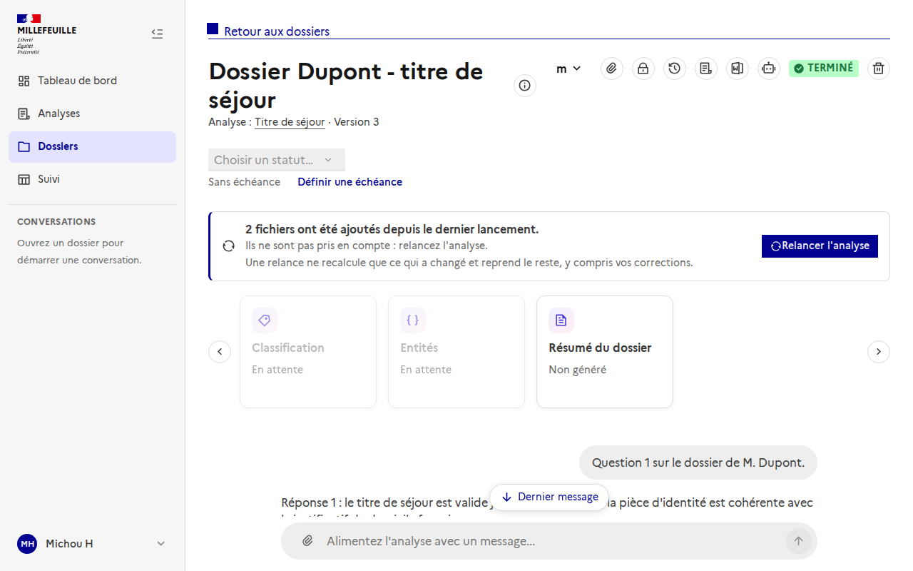
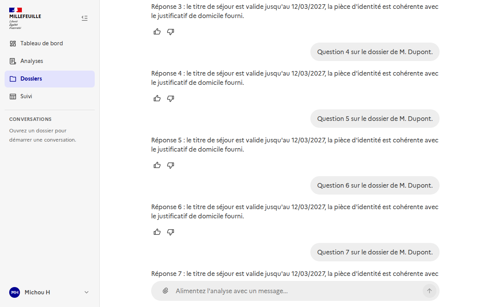
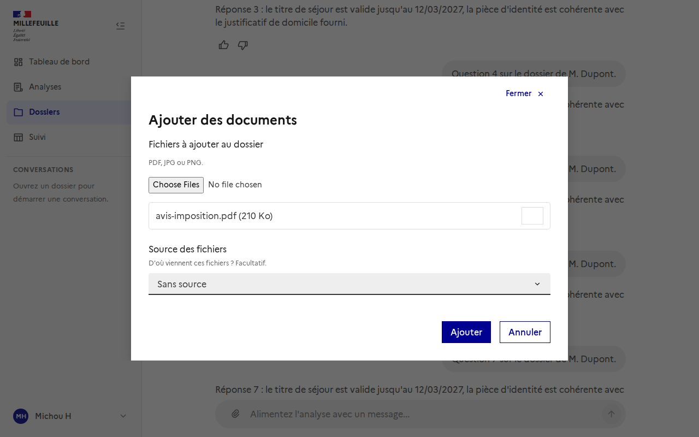

# Le chat d'un dossier : zone d'envoi, dernier message, fichiers joints

Le chat « Alimenter l'analyse » est en bas de la page d'un dossier.

> Les captures utilisent des données de démonstration.

## La zone d'envoi reste visible

La zone d'envoi est **collée au bas de l'écran** sur toute la page : on peut remonter lire les résultats du dossier, ou le début de la discussion, sans la perdre. (Elle ne restait auparavant visible que lorsque la section du chat était à l'écran.)

## Revenir au dernier message

Dès que le bas de la discussion n'est plus visible, un bouton **Dernier message** apparaît au-dessus de la zone d'envoi. Il ramène en douceur au dernier message et disparaît une fois arrivé.

## Joindre un fichier au dossier

Le **trombone** de la zone d'envoi ajoute des fichiers (PDF, JPG, PNG) au dossier. Il ouvre la fenêtre « Ajouter des documents » avec les fichiers déjà listés, pour choisir leur **source** avant l'envoi (voir [Ajouter des fichiers à un dossier, avec leur source](../sources-des-fichiers/README.md)).

Comme partout, l'ajout n'est refusé dans aucun état du dossier : si l'analyse a déjà tourné, la page propose de la relancer.

## Pour les développeurs

- `ChatWindow` : la propriété `pageComposer` (chat intégré à une page qui défile) rend la zone d'envoi collante sur toute la page ; `showFileAttach` affiche le trombone, qui émet `attach-files`.
- `App.vue` : le contenu principal est en `overflow: auto`, donc il serait le conteneur de défilement d'un élément `sticky` sans jamais défiler. Les routes qui en ont besoin portent `meta: { pageScroll: true }` : le contenu n'est alors plus un conteneur de défilement et c'est la page qui défile.
