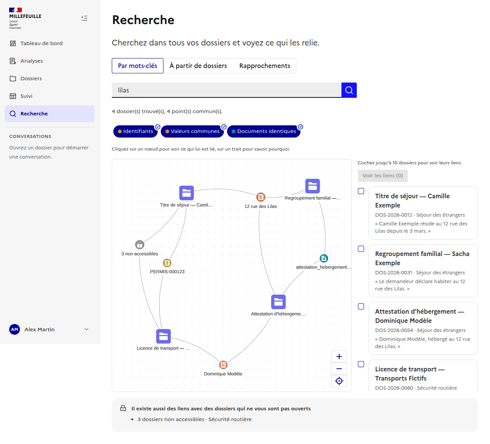
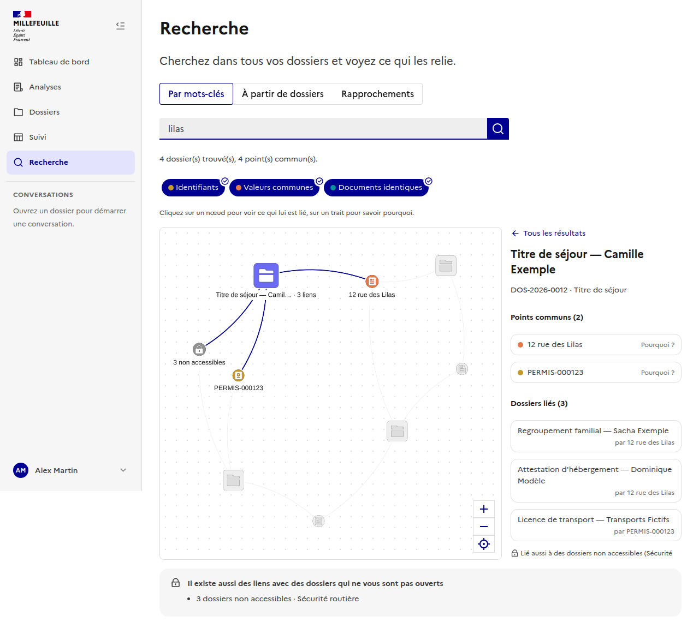
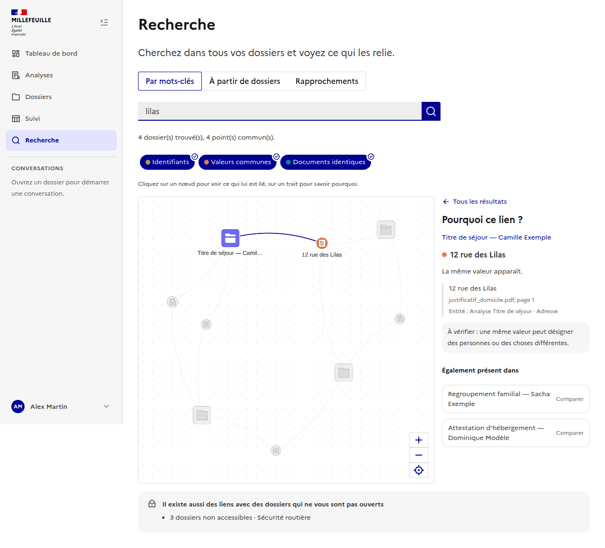
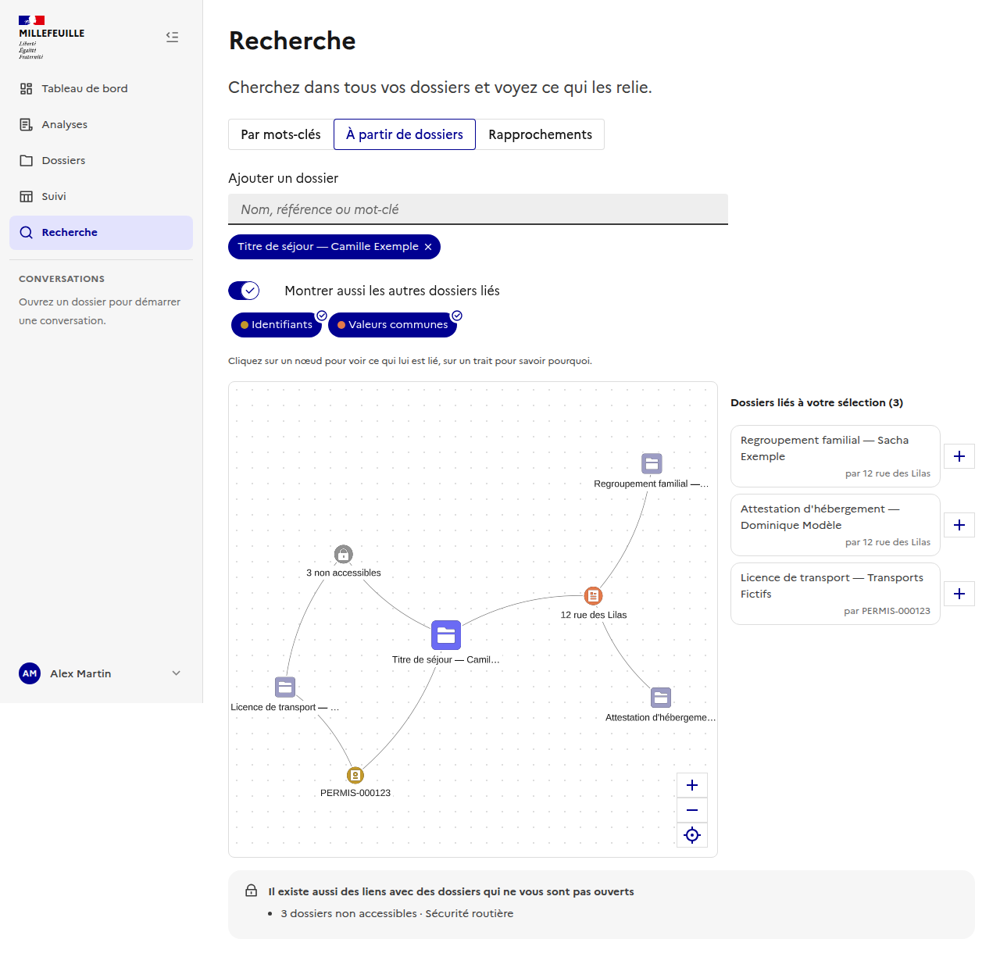
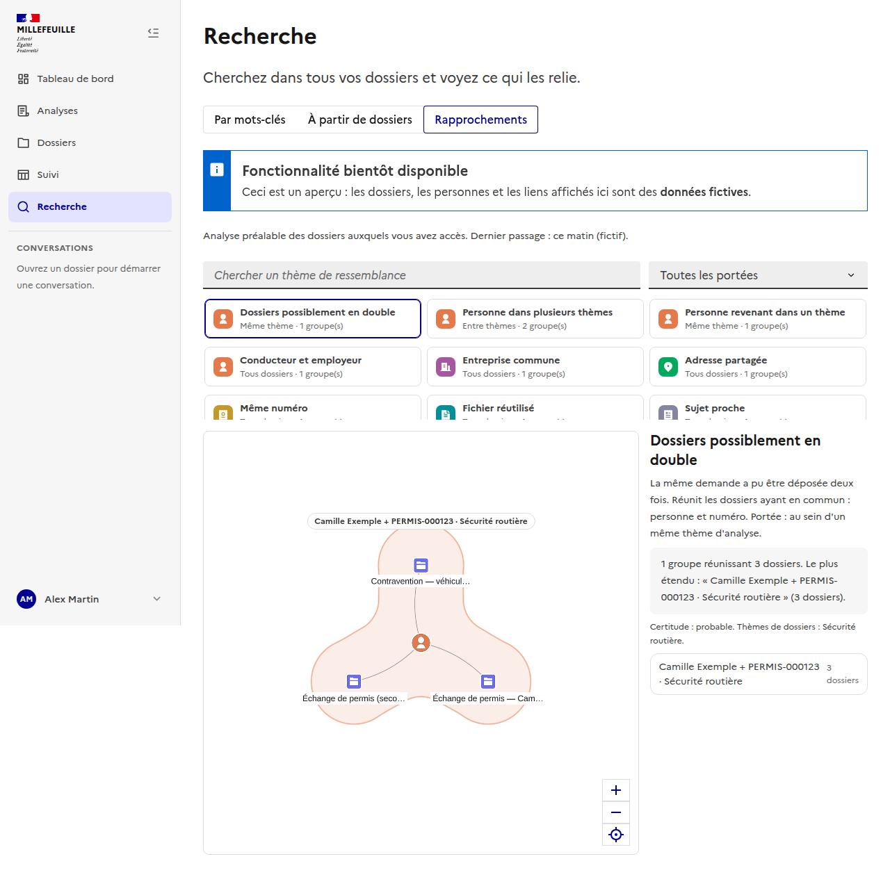

# Recherche à travers les dossiers : comment la ressemblance est faite

État actuel (PR #685). Les captures montrent des personnes et des dossiers **fictifs**, avec une API simulée.

## En bref

Aujourd'hui, deux dossiers se ressemblent seulement s'ils ont **exactement la même chose** :

- la même **valeur extraite** ;
- ou le même **fichier**.

Il n'y a **aucune ressemblance par le sens** : ni modèle, ni base vectorielle, ni comparaison de résumés. Elle est prévue dans #686.

| Écran | D'où viennent les liens | État |
|---|---|---|
| Par mots-clés | Entre les dossiers trouvés | Réel |
| À partir de dossiers | Autour des dossiers choisis | Réel |
| Rapprochements | Données fictives | Maquette |

## La règle commune

### Valeurs identiques

Sont comparées les **entités** et les **champs** de l'analyse courante de chaque dossier. La correction d'un instructeur remplace la valeur du modèle, et une valeur rejetée ne compte pas.

Avant comparaison, seuls les majuscules, les accents et les espaces en trop sont ignorés :

| Valeurs | Reliées ? |
|---|---|
| « Émile  Durand » et « emile durand » | oui |
| « Durand Émile » et « Émile Durand » | non |
| « AB-123-CD » et « AB123CD » | non |
| « Durand » et « Durant » | non |

**Le nom de l'entité n'est pas pris en compte** : la même valeur relie deux dossiers, que l'entité s'appelle « Hébergeant » dans l'un et « Gérant » dans l'autre. La preuve affiche l'origine de chaque côté, et c'est à l'instructeur de juger.

### Fichiers identiques

Deux documents sont identiques si leur contenu a la même empreinte. Un nouveau scan de la même pièce n'est pas reconnu.

### Ce qui ne relie pas

- Les dates, les nombres, les booléens et les classifications.
- Les valeurs vides (« oui », « non », « néant », « inconnu »…).
- Les valeurs de moins de 3 ou de plus de 200 caractères.
- Ce que partagent plus de 20 dossiers visibles, ou plus de 10 % d'entre eux (le plus grand des deux seuils).

### Les trois types de liens

| Type | Quand |
|---|---|
| Identifiant | La valeur partagée vient d'une entité de type « identifiant » |
| Valeur commune | Toute autre valeur partagée : nom, adresse, entreprise… |
| Document identique | Même fichier |

### Droits

Les liens sont calculés au moment de la demande, sur les seuls dossiers que la personne peut voir.

## Par mots-clés

1. **Trouver les dossiers.** Tous les mots doivent apparaître dans le dossier : nom, référence, noms des documents, valeurs extraites ou texte des pages. La recherche accepte les accents manquants, les pluriels et les débuts de mots. Elle compare des mots, pas des idées.
2. **Les relier.** Seuls les 20 dossiers affichés sont comparés entre eux. Un point commun doit toucher au moins deux d'entre eux, et 40 points communs au plus sont montrés.

Dans le graphe, un carré est un dossier, un rond un point commun. Les étiquettes au-dessus masquent un type de lien.

### Détail d'un dossier

Un clic sur un dossier montre ses points communs et les dossiers qui les partagent. Les dossiers liés sont classés par nombre de points communs. Il n'y a **pas de score de ressemblance**.

### Pourquoi ce lien ?

La preuve donne la valeur telle qu'elle est écrite, le document, la page et l'origine (« Analyse X · entité »). Une valeur commune est signalée « à vérifier » : elle peut désigner des personnes ou des choses différentes.

## À partir de dossiers

On choisit 1 à 10 dossiers, depuis les résultats, la liste des dossiers ou la fiche d'un dossier.

- Avec « Montrer aussi les autres dossiers liés », on ajoute jusqu'à 20 dossiers qui partagent une valeur ou un fichier avec **au moins un** dossier choisi.
- Ceux qui relient le plus de dossiers choisis sont retenus en premier.
- Chaque point commun affiché touche au moins un dossier choisi.
- Seuls les liens directs sont calculés : pas de chaîne de dossier en dossier.

## Dossiers non accessibles

L'encadré « Il existe aussi des liens… » des captures n'apparaît que si l'annonce est activée (`SEARCH_HIDDEN_LINKS_ENABLED=true`). Elle est **désactivée par défaut**.

Elle compte, par thème d'analyse, les dossiers non visibles qui partagent une valeur ou un fichier avec les dossiers trouvés ou choisis. Ni nom, ni référence, ni motif du lien. Rien n'est annoncé à un administrateur, qui voit tout.

## Rapprochements (maquette)

**Rien n'est calculé sur les vrais dossiers.** Les thèmes, les groupes et les dossiers sont écrits à l'avance dans l'interface, et les thèmes modifiés sont perdus au rechargement.

La maquette illustre ce qui est envisagé : un thème impose des critères tous obligatoires, une portée et une certitude. Les thèmes « Sujet proche », « Personne » ou « Adresse » n'ont pas encore d'équivalent côté serveur.

## Ce qui est prévu

| Issue | Apport |
|---|---|
| #649 | Thèmes de ressemblance, entités équivalentes, calcul à l'avance |
| #686 | Ressemblance par le sens à partir du résumé des dossiers |
| #648 | Variantes d'une même valeur (ordre des noms, fautes de lecture, formats) |

## Voir aussi

- [Détail technique de l'API](../../backend/recherche-entre-dossiers.md)
- Refaire les captures : `node scripts/search-screenshots.mjs` depuis `frontend/`, avec le serveur de développement lancé.
