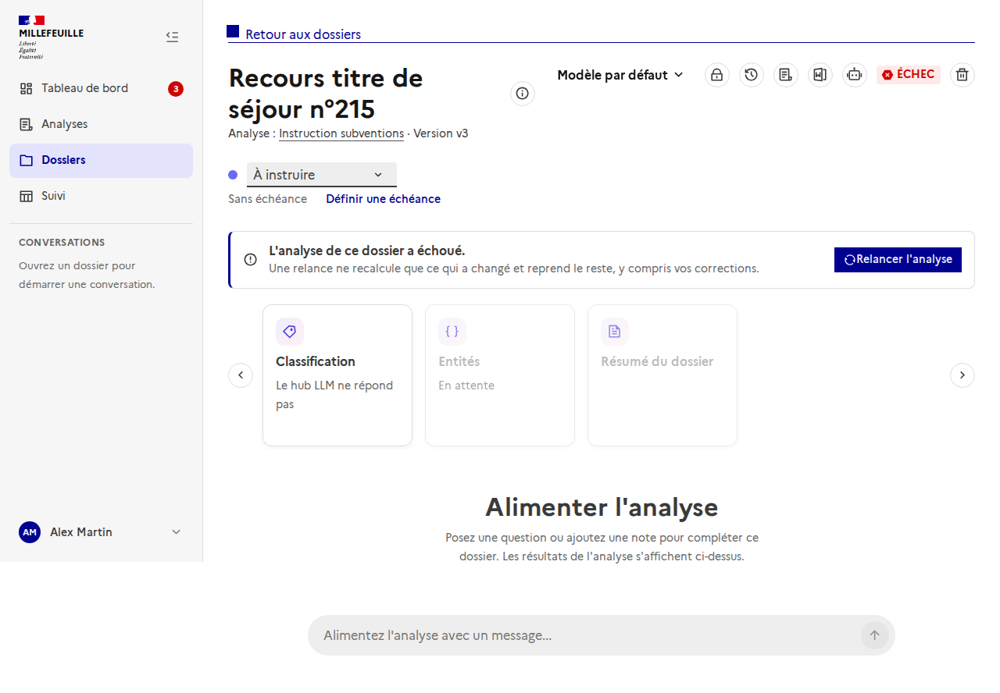
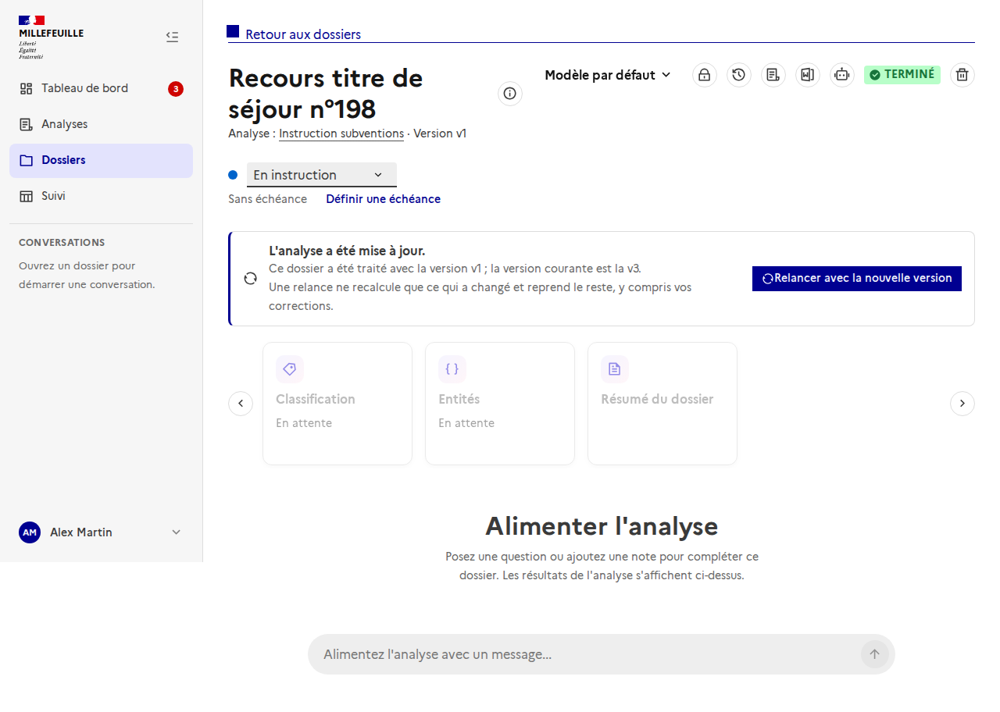
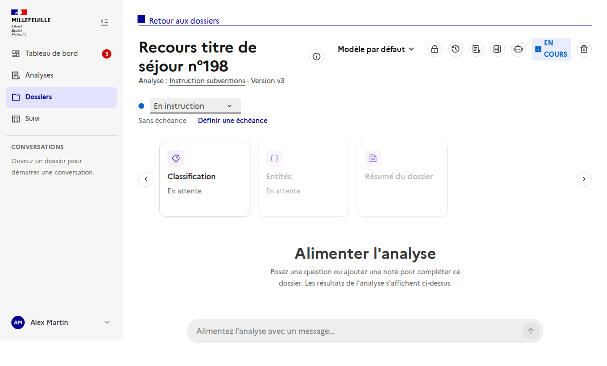

# Relancer l'analyse d'un dossier

Sur la page d'un dossier, un **bandeau « Relancer »** apparaît dans deux cas : la dernière exécution a **échoué**, ou l'**analyse a été mise à jour** depuis le dernier lancement du dossier. Il ne s'affiche pas pour un dossier en attente (on le lance depuis la liste), en cours, ou « à ranger » sans analyse.

## L'analyse a échoué

Le bandeau propose **Relancer l'analyse**. Dans la liste des dossiers, un dossier en échec a aussi un bouton **Relancer**.

## L'analyse a été mise à jour

Un dossier garde la **version de l'analyse** de son dernier lancement (« Version v1 » sous le titre). Quand l'analyse a changé depuis (prompt, labels, entités, agents...), le bandeau indique les deux versions et propose **Relancer avec la nouvelle version**.

## Après la relance

Le dossier repasse **En cours** et la page suit la nouvelle exécution.

## Ce que fait une relance

Elle crée une **nouvelle analyse de dossier** qui ne recalcule que les unités dont les entrées ont changé et **reprend les autres**, y compris les corrections des instructeurs. L'analyse précédente n'est jamais modifiée. Détails : [`relance-incrementale`](../../backend/relance-incrementale.md).

## API

- `POST /api/dossiers/{id}/launch` : lance ou relance (sans effet si le dossier est déjà en cours).
- `GET /api/analyses/{id}` expose maintenant `version` (v1, v2... : +1 à chaque changement enregistré), comparée à la version du dossier (`analyse_version`).

## Régénérer les captures

Serveur de dev lancé, depuis `frontend/` : `node scripts/doc-screenshots.mjs http://localhost:5173 relaunch` (API simulée, ni backend ni Keycloak).
