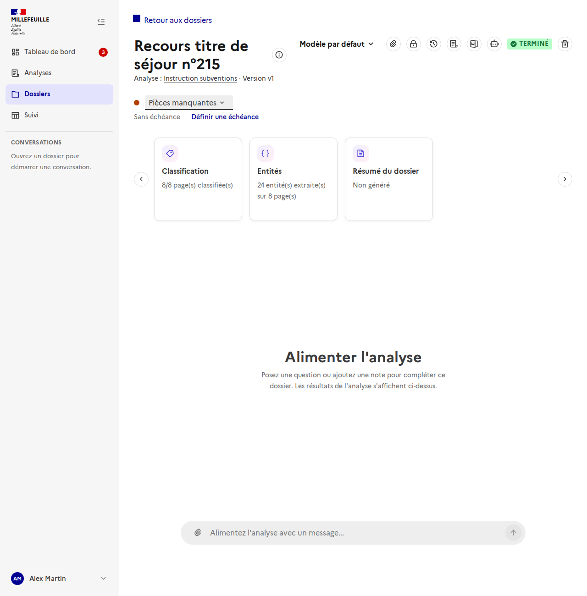
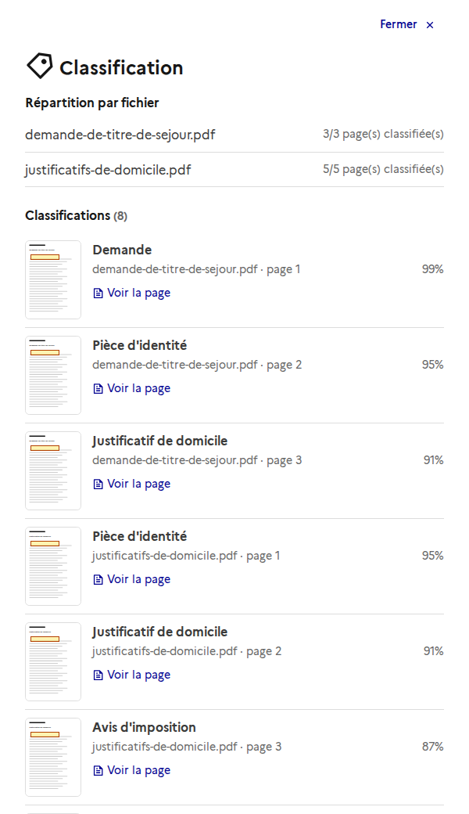
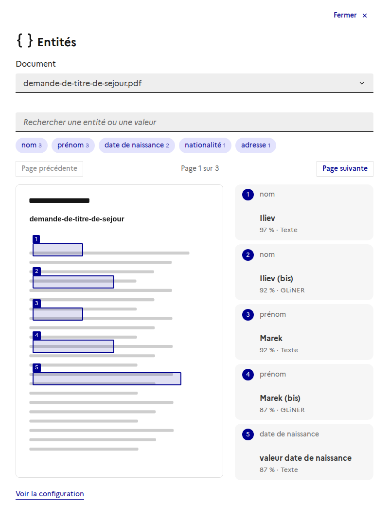
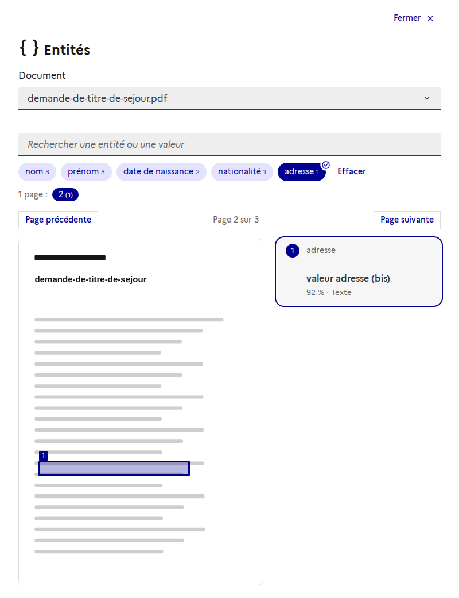
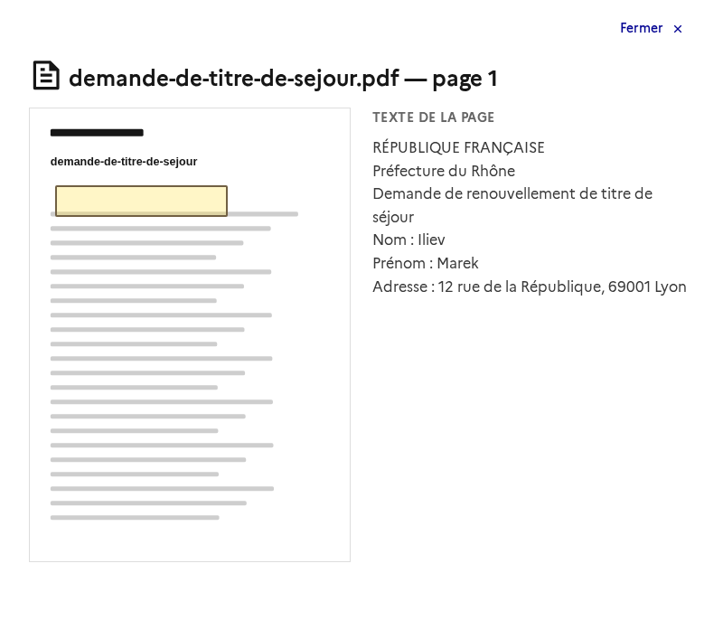

# Détail des résultats d'un dossier : classification et entités

Dans la page d'un dossier, les cartes **Classification** et **Entités** ne donnent qu'un compteur. Un clic ouvre le **détail** : la répartition par fichier, puis la liste paginée des résultats.

## Les cartes



- **Classification** : `8/8 page(s) classifiée(s)` compte les pages classifiées sur le **total des pages de tous les fichiers** du dossier.
- **Entités** : `24 entité(s) extraite(s) sur 8 page(s)`, même périmètre.

## Le détail d'une classification



- **Répartition par fichier** : pour chaque fichier, les pages classifiées sur ses pages totales. Un fichier ignoré ou en échec se repère ici.
- **Liste** : une ligne par page, avec une vignette de la page, le label, le fichier, le numéro de page et la confiance.

## Le détail des entités



Le détail des entités n'est pas une liste mais une vue **page par page** :

- **À gauche, la page** du fichier, avec un rectangle numéroté autour de chaque valeur localisée.
- **À droite, les entités de cette page**, numérotées comme les rectangles : nom, valeur, confiance et méthode (Texte ou GLiNER). Survoler ou sélectionner au clavier une entité met son rectangle en avant ; une valeur qui n'a pas pu être localisée est signalée « non localisée ».
- **Au-dessus**, une **recherche** sur les noms d'entités et les valeurs (sans tenir compte des accents ni de la casse), des **filtres par entité** (avec leur nombre de valeurs) et la **pagination** « Page précédente / Page suivante ».
- Quand une recherche ou un filtre est actif, les **pages concernées** sont proposées avec leur nombre de résultats : un clic y mène, et on arrive directement sur la première page qui correspond.
- Pour un dossier de plusieurs fichiers, un sélecteur de **document** choisit celui que l'on parcourt.



Les rectangles viennent de l'extraction : le span de GLiNER, ou la valeur retrouvée dans le texte de la page pour le LLM, relié aux mots positionnés par `document_process`. Un dossier traité avant cette fonctionnalité n'a pas de rectangles : relancer l'analyse les ajoute.

## Voir la page source

Chaque ligne de **classification** a un lien **Voir la page**. Il ouvre la page du fichier par-dessus la liste : la **capture** avec la **zone** du résultat encadrée, et le **texte de la page**. « Fermer » ramène à la liste, sur la même page.

C'est la même fenêtre que celle des sources citées par l'assistant dans le chat.



## API

| Route | Rôle |
| --- | --- |
| `GET /api/dossiers/{id}/results/breakdown` | Répartition par fichier : pages, pages classifiées, entités. |
| `GET /api/dossiers/{id}/results?kind=label\|entity&page=&page_size=` | Classifications ou entités, paginées (`page_size` : 10 par défaut, 100 au plus). |
| `GET /api/dossiers/{id}/extractions` | Les entités de chaque document, page par page, avec leurs `boxes` (rectangles normalisés de la page) : la vue du détail des entités. |

Chaque ligne de `results` (classification) porte le fichier, les `pages` (id et numéro) et les `bounding_boxes` qui permettent d'ouvrir la page source. La capture et le texte d'une page se lisent par `GET /api/dossiers/{id}/documents/{document_id}/pages/{page_id}` et `.../screenshot`, déjà utilisés par le chat.

Ces routes appliquent le même contrôle d'accès au dossier que les autres : un dossier non visible répond 404.

## Régénérer les captures

Avec le serveur de dev lancé (`pnpm dev`), depuis `frontend/` :

```bash
node scripts/doc-screenshots.mjs http://localhost:5173 results
```

L'API est simulée par le script : ni backend ni Keycloak ne sont nécessaires.
