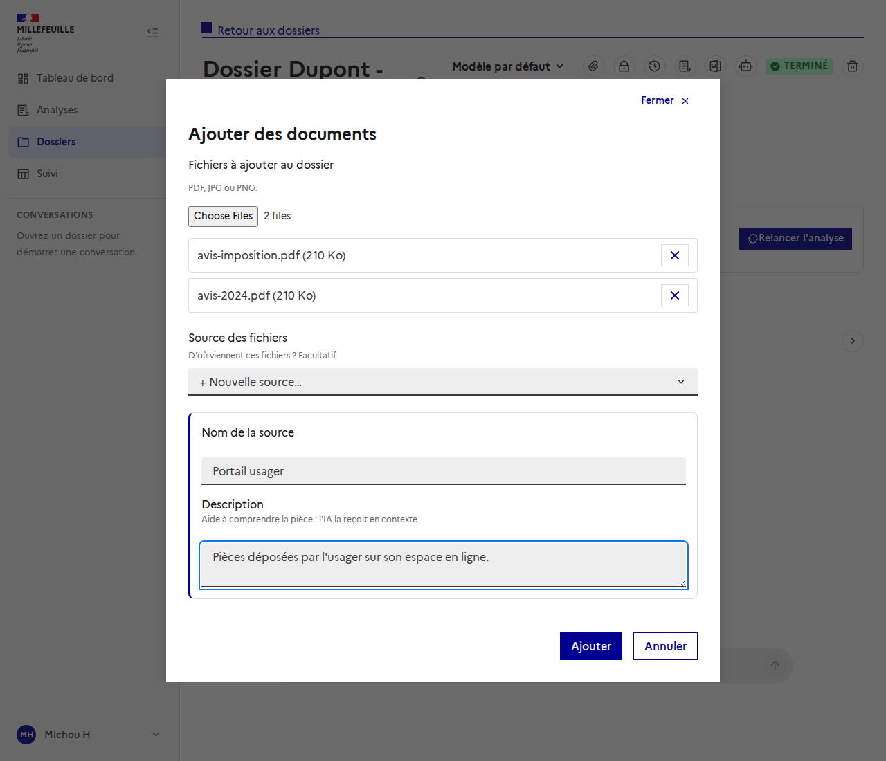
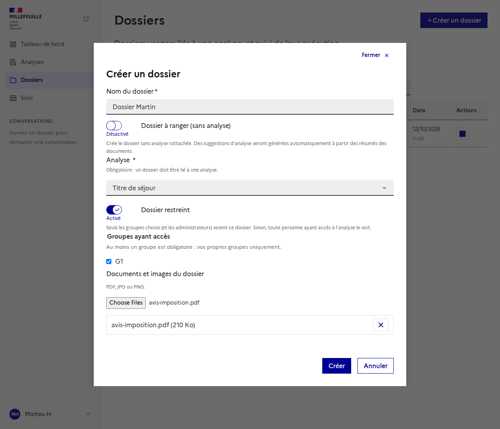
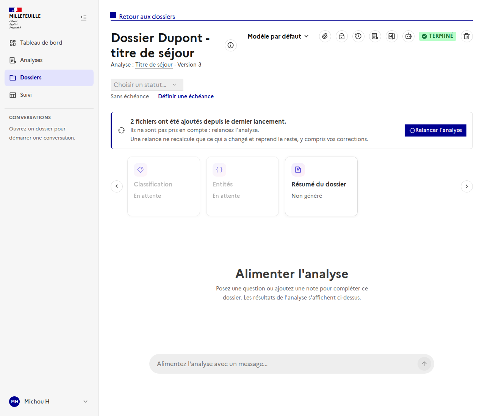
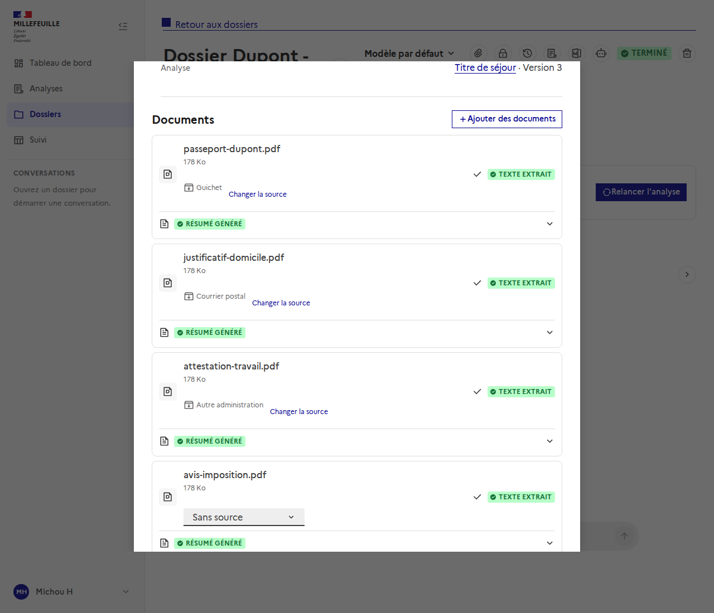
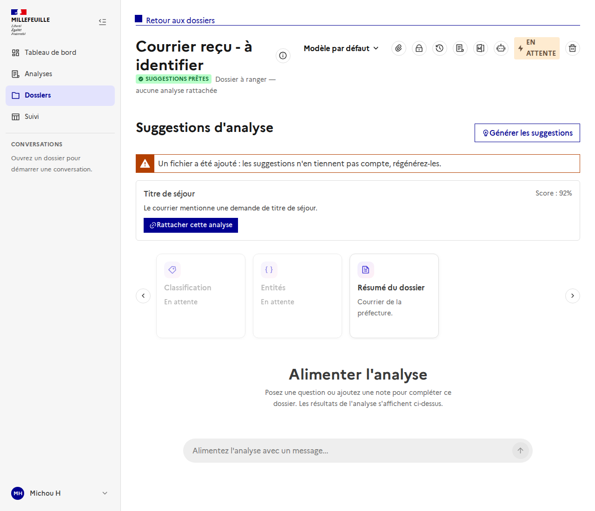
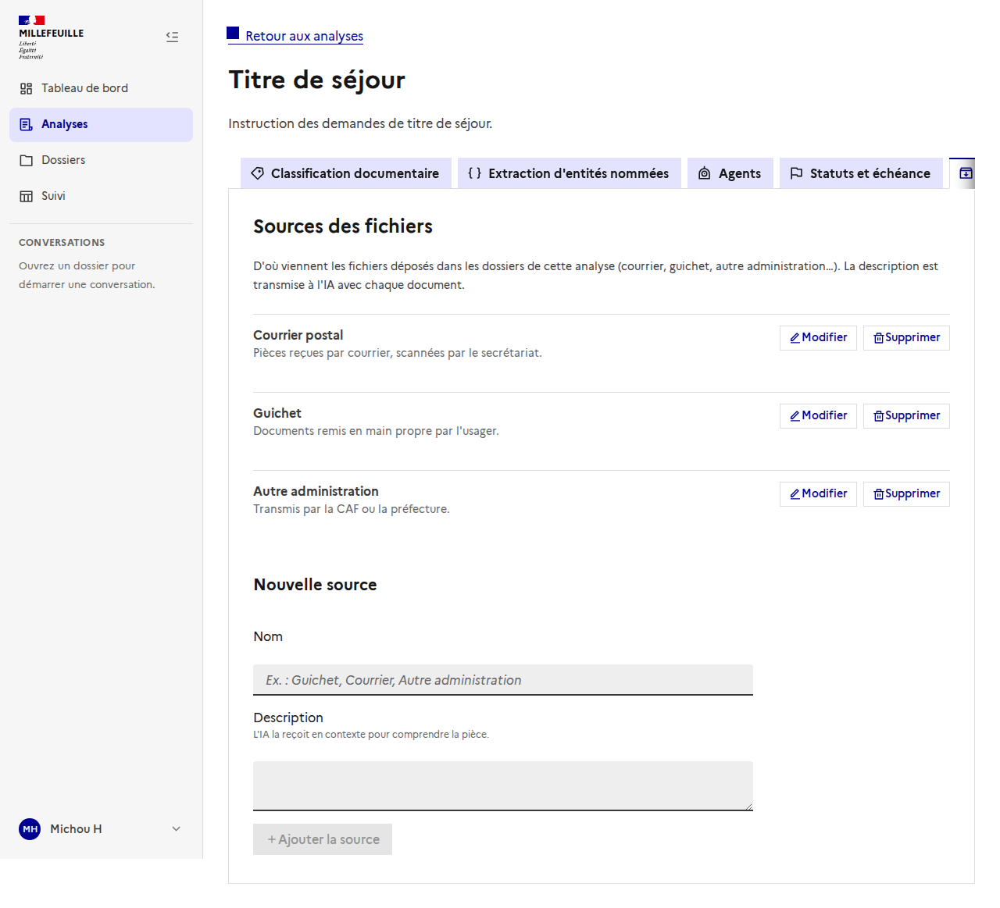

# Ajouter des fichiers à un dossier, avec leur source

API : [`sources-fichiers`](../../backend/sources-fichiers.md). Schéma de la base : [`data-model.png`](../../backend/data-model.png) (table `document_sources`, colonne `dossier_documents.source_id`).

On peut **ajouter des fichiers à un dossier déjà créé**, quel que soit son état, et dire **d'où ils viennent** : leur **source**. Une source est libre, définie par l'utilisateur (courrier, guichet, autre administration…), avec une **description** que l'IA reçoit en contexte.

> Les captures utilisent des données de démonstration.

## Ajouter des documents

Dans l'en-tête d'un dossier, l'icône pièce jointe ouvre « Ajouter des documents » ; le même bouton est en haut de la liste des documents (détail du dossier).

- **Fichiers** : PDF, JPG ou PNG, plusieurs à la fois ; chacun se retire avant l'envoi.
- **Source des fichiers** : *Sans source* (facultatif), une source existante, ou **+ Nouvelle source…** (nom + description), créée à l'envoi. La source choisie s'applique à **tous les fichiers du dépôt**.
- **Aucun refus** : l'ajout est possible dans tous les états du dossier, y compris pendant une exécution.

À la création d'un dossier, le même choix de source apparaît dès qu'un fichier est sélectionné.

## Il faut relancer

Les fichiers ajoutés après le dernier lancement ne sont **pas pris en compte** par l'analyse déjà faite. Le bandeau de relance le dit, sans rien bloquer :

- Le bandeau compte les fichiers déposés **depuis le dernier lancement** et propose de relancer l'analyse (une relance ne recalcule que ce qui a changé et reprend le reste).
- Si une **exécution est en cours**, le bandeau prévient mais la relance n'est possible qu'à sa fin.

## La source de chaque document

Dans le détail du dossier, chaque document affiche sa source (la description s'affiche au survol). « **Changer la source** » (ou « Ajouter une source ») la modifie ; *Sans source* la retire.

## Dossier « à ranger »

Un dossier à ranger n'a pas d'analyse, donc pas de catalogue : on peut quand même y créer des sources. Elles sont des **tampons**, visibles dans ce seul dossier. Quand le dossier est rattaché à une analyse, ses sources **rejoignent le catalogue de l'analyse** (fusionnées si le nom existe déjà), et les documents les gardent.

Après un ajout, les suggestions d'analyse ne tiennent pas compte des nouveaux fichiers : l'interface invite à les **régénérer**.

## Le catalogue d'une analyse

L'onglet « **Sources** » de l'analyse liste les sources proposées pour ses dossiers : ajouter, modifier, supprimer. Supprimer une source utilisée est permis : ses documents **restent, sans source**. Les sources ne sont **pas versionnées** : il n'y a ni historique ni restauration.

## Ce que l'IA en fait

La description de la source est donnée en contexte à la **classification**, à l'**extraction**, aux **agents**, au **chat** et aux **résumés** du dossier. Elle entre dans l'empreinte des calculs seulement si le document a une source : une relance ne recalcule que les documents dont la source a changé.
